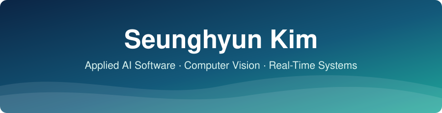

Building practical AI systems that connect **models, data, and software**.

[Portfolio](https://ksh0330.github.io/) ·
[CV](https://ksh0330.github.io/cv/) ·
[LinkedIn](https://www.linkedin.com/in/sghnkim/) ·
[Velog](https://velog.io/@ksh0330)

---

### Highlights

- **ETRI internship (2024)** — EO/IR drone detection pipeline, about **0.6 s** from video input to display; Best Paper Presentation Award, IEMEK 2024
- **First-author journal paper (2025)** — lane-wise speed estimation (max error **5.66 km/h** on real roads) and MLP risk classification (**89%**, **5 ms** on model-intersection test videos)
- **VITAS (team lead)** — Capstone Design Grand Prize, AIoT Service Design Grand Prize, Hanium ICT Contest Finalist
- **GRIT Edu** — built and operate an academy LMS/CMS (239 students, 21 instructors as of Nov 2026)

### Selected Projects

| Project | Summary | Stack | Links |
| --- | --- | --- | --- |
| **EO/IR Drone Detection** | Real-time EO/IR drone video pipeline over private 5G | YOLOv9, TensorRT | [Page](https://ksh0330.github.io/projects/eo-ir-drone-object-detection/) |
| **VITAS** | Intersection accident-risk system: speed estimation and risk classification | YOLOv8, OpenCV, PyQt | [Page](https://ksh0330.github.io/projects/vitas/) · [Repository](https://github.com/ksh0330/Project-VITAS) |
| **RideSure** | Boarding-likelihood check and route comparison from public data | FastAPI, Neo4j | [Page](https://ksh0330.github.io/projects/ridesure/) · [Code](https://github.com/ksh0330/RideSure) |
| **GRIT Edu LMS/CMS** | Academy website, LMS, and CMS in live operation | JavaScript, Firebase | [Page](https://ksh0330.github.io/projects/grit-edu-lms/) · [Snapshot](https://github.com/ksh0330/gritedu-lms) · [Live](https://gritedu.kr) |

More: [TeleGuideRAG](https://github.com/ksh0330/TeleGuideRAG) · [YouTube Live STT](https://github.com/ksh0330/youtube-live-transcript-stt) · [JeJuOneEyes](https://github.com/ksh0330/JeJuOneEyes) · [all projects](https://ksh0330.github.io/projects/)
### Tech Stack

- **Languages** Python · C · C++ · JavaScript · Java · R
- **Data & ML** NumPy, Pandas, Matplotlib, Jupyter, Hugging Face, ONNX, CUDA, Roboflow, LangGraph, ChromaDB, Whisper
- **Web & Infra** HTML/CSS, Django, Vue, Node.js, Cloudflare
- **Embedded & Robotics** Arduino, ATmega128, Raspberry Pi, ROS
